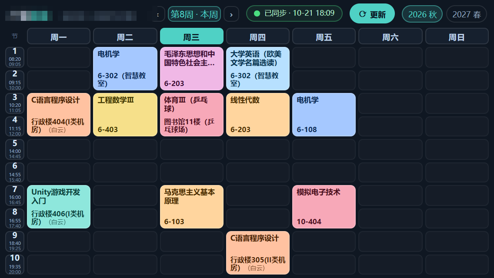
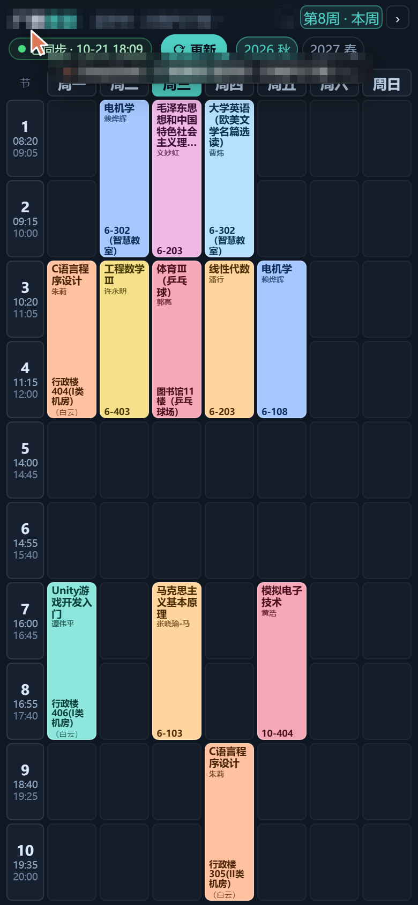
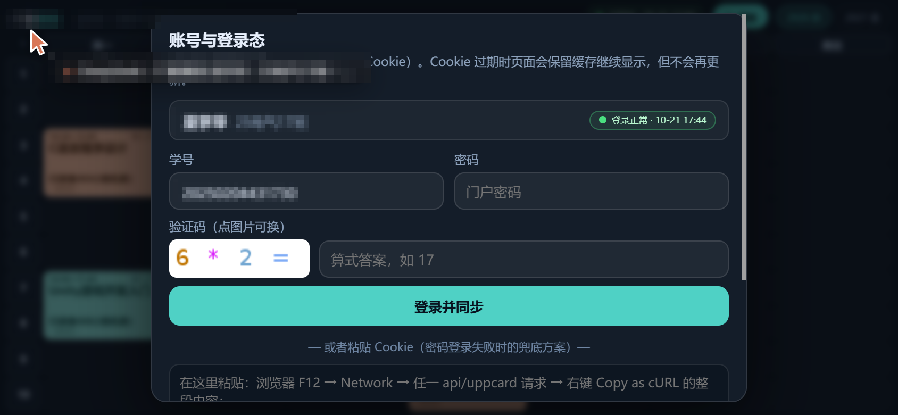
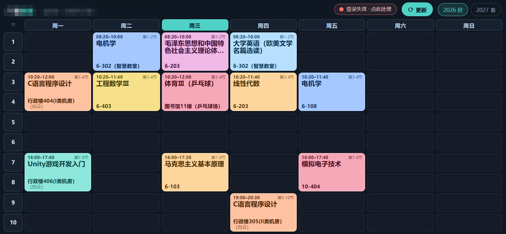
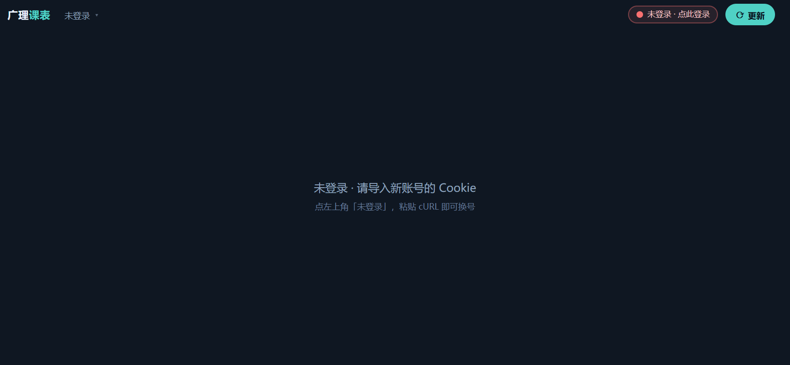

# 广理课表 · 门户课表逆向 + 手机一屏课表

> 学校把课表入口关了。本项目通过逆向「融合门户」的课表接口，用**本人登录态**直接取回整学期课表，
> 并把它做成一个**手机一屏看完整周**的网页（横屏、竖屏都支持，不用转屏）。

仅用于查看本人课表，请勿用于抓取他人数据或压测学校服务器。

---

## 效果

| 手机横屏 844×390 | 小屏横屏 568×320 | 手机竖屏 390×844 |
| --- | --- | --- |
|  |  |  |

顶栏的周次切换（`‹ [第8周 · 本周] › 本周`）：

| 手机横屏 844×390 | 小屏横屏 568×320 |
| --- | --- |
|  |  |

---

## 作业要求对照

| 要求 | 实现 |
| --- | --- |
| 展示课程名称（可以不完整） | ✅ 最多 2 行，超出省略号截断 |
| 展示教室号（**完整**） | ✅ 单独成行、可换行、**绝不省略**；`（白云）` 校区后缀拆成小字整体换行 |
| 有上下课时间（**完整**） | ✅ 时间只放在左侧栏，每节两行 `08:20` / `09:05`，10 节课一节不漏 |
| 完整展示 | ✅ 7 天 × 全部节次一屏铺满、无滚动；横屏竖屏都行（竖屏自动换成窄列排版） |
| 按周次查看 | ✅ 顶栏 `‹ 第N周 › 本周`：整学期 20 周都抓到本地，换周零延迟，当前周标「· 本周」 |
| 前端（加分项） | ✅ 零依赖单文件、按课程自动配色、今日列高亮、学期切换、安全区适配、**打开即见 + 后台自动更新 + 断网可用** |

---

## 目录结构

```
广理课表/
├─ server/
│  └─ server.mjs          # 零依赖本地服务：托管 Cookie、定时同步、静默续期、/api/*
├─ scripts/
│  └─ import-cookies.mjs  # 登录失效时，把浏览器 Cookie 一键导入服务端
├─ fetch/
│  └─ fetch.mjs           # 纯脚本抓取（给定 token 直接出 JSON），不依赖服务端
├─ web/
│  ├─ index.html          # 前端（单文件，无依赖）
│  ├─ data.json           # 最近一次抓取结果
│  └─ data.js             # 同 data.json，包成 window.__KB_DATA__（file:// 兜底）
├─ data/
│  └─ auth.json           # Cookie Jar + 学生信息（本地私密，别提交/别外传）
├─ docs/
│  └─ 逆向说明.md          # 入口分析、接口清单、字段、作息、服务端与前端数据流
├─ shots/                 # 各尺寸截图
└─ README.md
```

---

## 快速开始

### 方式 A：只看课表（最省事）

```bash
node server/server.mjs      # 或 npm start
# 浏览器打开 http://127.0.0.1:8787
```

服务会把课表同步到 `web/data.json`，页面**先显示缓存、再自动更新**，顶栏胶囊显示更新时间。

### 方式 B：手机同局域网访问

```bash
node server/server.mjs
# 手机与电脑同一 WiFi，浏览器打开 http://<电脑局域网IP>:8787 ，横屏竖屏都行
```

### 方式 C：完全静态（不带服务）

直接双击 `web/index.html`。用的是 `web/data.js` 内置数据，
也能连上 `127.0.0.1:8787` 时自动取最新，取不到就显示缓存。

---

## 登录态怎么维持

### ① 直接用学号密码登录（推荐，手机也能用）

点左上角**账号名** → 面板里填 **学号 / 密码 / 验证码（算式答案）** → **登录并同步**。

服务端把这几个字段按 CAS 的登录表单提交给 `ids.gzist.edu.cn`（协议逆向见 docs 第 11 节），
拿到门户 Cookie 后立刻同步一次课表并落盘，之后就不用再登录了。

> 密码只在这一次请求里透传给学校 CAS，不落盘、不写日志、不离开你本机。

### ② 粘贴 Cookie（兜底通道）

门户登录态在 Cookie 里（部分 `HttpOnly`，浏览器 JS 读不到），所以由**服务端持有 Cookie**：

1. 首次（或登录失效后）：浏览器登录 <https://portal.gzist.edu.cn>，
   F12 → Network → 任选一个 `api/uppcard/...` 请求 → 右键 **Copy as cURL** → 保存为 `clip.txt`
2. 导入：

   ```bash
   node scripts/import-cookies.mjs clip.txt
   # 也支持直接粘贴：node scripts/import-cookies.mjs "SESSION=xxx; token=yyy"
   ```

3. 之后服务端每 `SYNC_MIN`（默认 15）分钟同步一次，每 `KEEPALIVE_MIN`（默认 5）分钟
   用 `CASTGC` 静默续期，只要 `CASTGC` 没过期就能长期免登录。

顶栏出现 **`登录失效 · 点此处理`** 时，点它会弹出上面这套步骤。

### 环境变量

| 变量 | 默认 | 说明 |
| --- | --- | --- |
| `GL_CARD_ID` | 空 | 课表卡片实例 id（门户「学生课表」卡片 api/uppcard 请求里可见，必填） |
| `GL_PORT` | `8787` | 服务端口 |
| `SYNC_MIN` | `15` | 自动同步间隔（分钟） |
| `KEEPALIVE_MIN` | `5` | 会话保活间隔（分钟） |

---

## 换账号 / Cookie 过期了怎么办

点左上角**账号名**，弹出「账号与登录态」面板：

| 截图 | 说明 |
| --- | --- |
|  | 面板：当前账号 + 学号密码验证码登录 + 粘贴 Cookie 兜底 |
|  | Cookie 过期：胶囊变红，但**课表照常显示** |
|  | 主动退出后：清空数据，等新账号导入 |

**Cookie 过期会发生什么**（重点：不会丢数据）

1. 服务端请求被弹回登录页 → 先自动用 `CASTGC` 静默续期，成功则你完全无感；
2. 续期失败 → 胶囊变红「登录失效 · 点此处理」，**已抓到的课表继续显示**（缓存可用），只是不再更新；
3. 后台每 15 分钟自动重试；也可以在面板里直接输学号密码重登，恢复后自动变绿。

**换账号**：面板里填新账号的学号 / 密码 / 验证码登录即可。登录是在一份**干净的 Cookie 罐**里做的——
成功才替换旧账号，失败则原样恢复旧登录态，不会把当前能用的账号弄掉。

面板里的按钮：

- **登录并同步**：走 CAS 登录（学号+密码+验证码）→ 立刻同步课表，成功后替换旧账号；
- **导入并同步**：粘贴 `Copy as cURL` 的兜底通道（先清旧账号 Cookie 与旧课表，避免串号）；
- **打开门户登录**：新窗口打开门户，方便手动登录后去拿 cURL；
- **退出 / 更换账号**：清空服务端 Cookie + 本地缓存 + 课表数据，回到「未登录」。

> 姓名来自「学号→姓名」记忆表（门户没有"当前用户"接口），登录过的账号会自动记住；
> 没记录过时显示「学号 · 某某班」，班级从课表的教学班名解析（详见 docs 第 10 节）。

---

## 接口一览（本地服务）

| 方法 | 路径 | 说明 |
| --- | --- | --- |
| GET | `/api/schedule` | 课表数据 + 同步状态 |
| GET | `/api/status` | 仅状态：`status / lastSyncAt / lastError / needLogin / hasCookies` |
| POST | `/api/sync` | 立即同步（前端「更新」按钮） |
| GET | `/api/auth/captcha` | 取 CAS 登录验证码：`{uid, image}` |
| POST | `/api/auth/login` | 学号密码登录：`{username, password, code, uid}` |
| POST | `/api/auth/cookies` | 导入 Cookie |
| POST | `/api/auth/logout` | 退出 / 换账号（`{wipe:true}` 连课表数据一起清） |

门户上游接口（逆向所得）与字段说明见 **[docs/逆向说明.md](docs/逆向说明.md)**。

---

## 实现要点

- **一屏整周**：CSS Grid，列 = 节次列 + `repeat(7, 1fr)`，行 `minmax(0,1fr)`，容器 `100dvh` 撑满，
  横屏 844×390 / 667×375 / 568×320、竖屏 390×844 / 360×780 / 320×568 都能一屏显示、不滚动、无文字溢出。
- **字号跟着课块长**：课程块用容器查询（`container-type:size` + `cqh`），
  块矮就自动缩小字号、隐藏「第 x-y 节」，优先保住**时间**和**教室**。
- **精确到每一节**：作息时间用学校课表 App 的逐节时间表（`08:20–09:05`、`10:20–11:05`…），
  **左侧栏**每节显示「节号 + 上课时间 + 下课时间」，课程卡片里不再重复时间与节数（跟学校课表 App 一致）。
- **卡片只放三样**：课程名（可截断）/ 教师 / 教室（完整），长按或悬停可看完整信息。
  接口只给"第几节"，钟点由 `BELL` 表换算，改时间只需改这一处。
- **缓存优先 + 后台更新**：`localStorage` 缓存保证打开即有画面；随后拉 `/api/schedule`，
  `fetchedAt` 变了才重渲染，不闪屏；断网时降级为「离线 · 缓存」并照常显示。
- **数据可追溯**：每周保留合并后的 `blocks`（课程名 / 教室 / 教师 / 教学班 / 起止节次）。
- **周次参数是 `results`**：门户课表接口 `queryAWeekSchedule` 的周次参数不叫 week，
  而是 `results=<周次>`（留空＝当前周）；服务端一次性抓完 1…`weekcount` 周，
  前端换周只是切数组，因此**翻周零延迟、断网也能翻**。

---

## 免责声明

- 数据来自本人账号登录后的个人课表接口，仅本地查看，`data/auth.json` 含登录凭据请勿外传。
- 请遵守学校相关规定，不要复用本项目抓取他人数据或对服务器造成压力。
